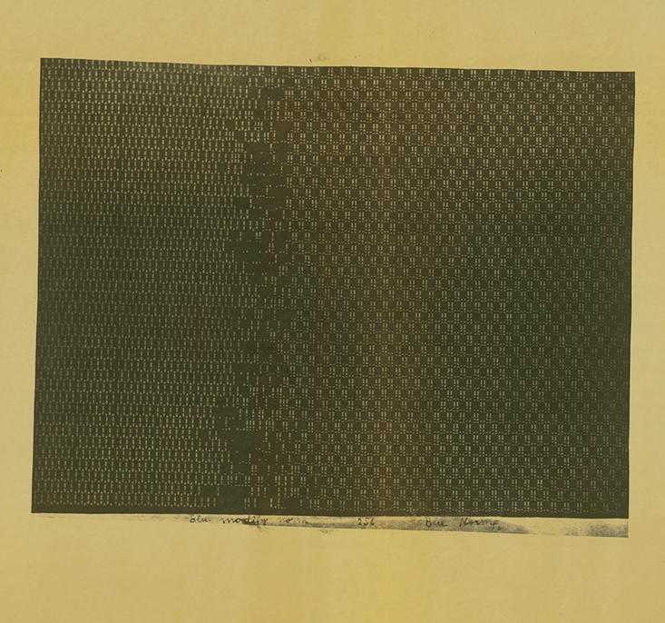

# Nils Aall Barricelli's 1954 paper translated

Have you heard of [Nils Aall Barricelli](https://en.wikipedia.org/wiki/Nils_Aall_Barricelli), the ALife pioneer from the early 1900s who ran evolutionary simulations on military computers in the 1950s?
Nautilus published a great article about him back in 2014: [Meet the Father of Digital Life](https://nautil.us/meet-the-father-of-digital-life-234937).

Giulia Bianchi and Tim Taylor teamed up to translate his 1954 paper “Esempi Numerici di Processi di Evoluzione” (Numerical Examples of Evolutionary Processes) from Italian to English! It is in the ALife journal (closed access): [Numerical Examples of Evolutionary Processes](https://direct.mit.edu/artl/article-abstract/doi/10.1162/ARTL.a.485/138671/Numerical-Examples-of-Evolutionary-Processes?redirectedFrom=fulltext) or open access [here](https://www.tim-taylor.com/papers/barricelli2026numerical.pdf).
