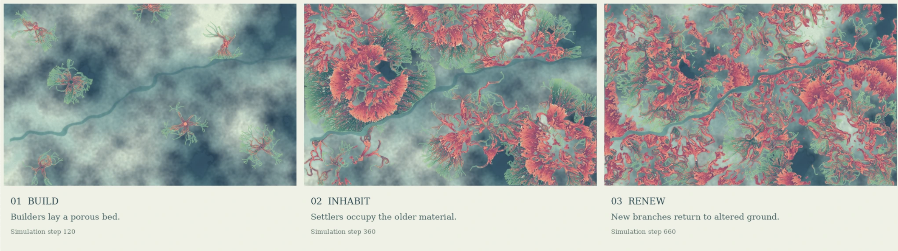

# Intelligence in Nature — Artificial Life, Emergence, and Computational Form

_Shared by Yuvraj Mittal _

Portfolio: [yuvrajmittal.com](yuvrajmittal.com)

Intelligence in Nature is a collection of four computational artworks exploring how intricate, organic forms emerge from local interactions in artificial-life systems.

Through simulations inspired by fungal networks, cellular growth, and other living processes, the collection explores emergence as both a computational phenomenon and an artistic medium. Rather than depicting biological forms directly, the works allow structures and patterns to develop through simulated dynamics.

Each piece is presented as a moving artwork, accompanied by an explanation of its underlying process, source code, and reproduction instructions.

The collection includes Anastomosis, Interstices, Pelagic, and Inhabited Ground
