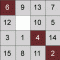

# 3D Game of Life
*summary by Claus*

Last month Imy was looking into 3D versions of the game of life. Out
of several projects, [Cubic Life](https://github.com/xms0g/cubicLife)
looked the best.

Each cell looks at its 26 neighbors (+-1 in all 3D directions). A live
cell becomes death with less than 5 or more than 6 neighbors. A dead
cell becomes alive with exactly 4 neighbors. 

The website does not have a lot of information on the hows and whys of
these rules, but it is interesting to think how the addition of an
extra dimension interacts with the celular automata rules. Personally,
I'm curious about why the birth rule ends up being outside the
boundaries of the death rule, unlike 2D GoL.

Do you know any interesting materials or theories about 3D GoL? Send
us a message!

