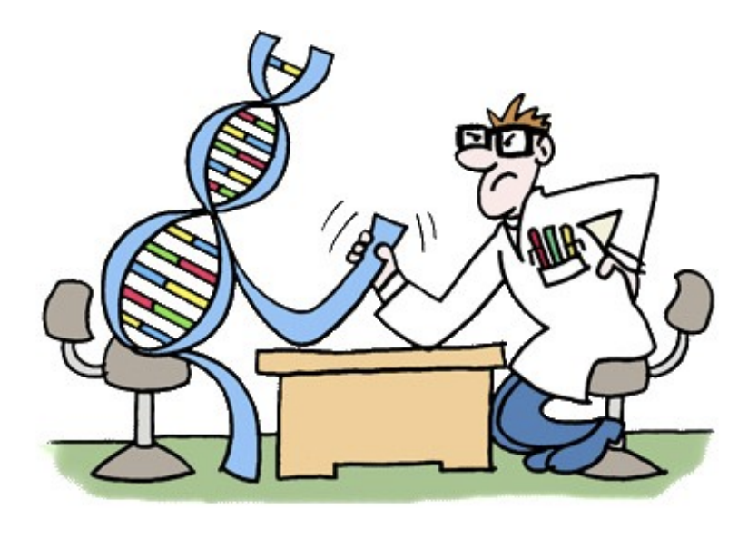

# 23 rd Human-Competitive Results Awards (“Humies”), 2026

Shared by Erik Goodman, edited for length by Lana

GECCO 2026 was held July 13-17 this year;
around 400 people came to San José, Costa Rica to attend in person, and an additional
200 or so registered to attend virtually. The Humies annually awards $10,000 in cash prizes for computational
results that are deemed to be competitive with results produced by humans but are
generated automatically by computers. The finals of the [Humies competition](www.human-competitive.org) was a plenary session attended by
about 75 people. The six finalists 
selected from among 9
entries this year presented
their work in 10-minute talks.

All entries and the presentation
materials of the six finalists are available at www.human-competitive.org.
The judges for the competition were Anne Auger,
Wolfgang Banzhaf, Stephanie Forrest, Emma Hart, Lee Spector and Darrell Whitley.
Publicity for the Humies was done by Bill Langdon. 

[Video of the Humies session](https://whova.com/portal/webapp/CLaCF4Vax5Yr4znoFfNi/Agenda/4711408)

## Gold Award
The Gold, with a $5,000 prize, was awarded to the team from Google headed by (and
presented by) Esteban Real. Their paper was entitled
“AutoNumerics-Zero: Automated Discovery of State-of-the-Art Mathematical Functions”
show
that transcendental functions, such as the exponential, can be approximated more
efficiently by targeting only the finite precision required by modern computers rather
than arbitrary mathematical accuracy. Using symbolic regression, an evolutionary
algorithm discovers new combinations of basic arithmetic operations that optimize both
accuracy and computational efficiency without relying on prior mathematical
knowledge.

## Silver Award

The Silver Award and $3,000 went to a team
which included Chao Qian (Nanjing
University),
and fifteen co-authors. Their paper is entitled,
“Complex marine ecological response during
the Eocene-Oligocene revealed by global
foraminiferal record.” Their results show that different
ecological groups of foraminifera responded in distinct ways, rather than experiencing a
single, uniform extinction event.

## Bronze Award 

One Bronze Award and $1,000
went to a team from University of
Toulouse Capitole, and their
presentation was by Christina
Berghegger. Their paper was
entitled, “Analyzing Interpretable
Visual Control Policy Search and
Synthesis.” Their study
presents an interpretable
approach to vision-based
sequential decision-making using
Graph-based Genetic Programming (GGP) as an alternative to black-box deep
reinforcement learning. 

Another Bronze Award and $1,000 went to the team of Arinze Obidiegwu et al, from University of Limerick and Atlantic
Technological University. Their paper is entitled “Evolving Hardware-Efficient Grover
Circuits with Grammatical Evolution”.
The paper explores the use of Grammatical Evolution (GE) to automatically design
quantum circuits that are optimized for today's noisy quantum hardware. Rather than
relying on the standard, general-purpose implementation of Grover's algorithm, the
authors evolve specialized circuits for each 3-qubit computational basis state.
